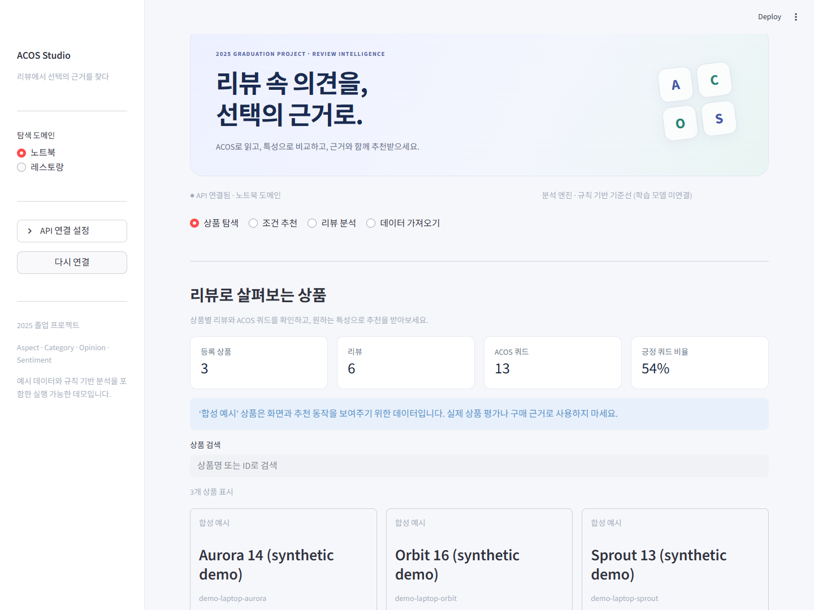
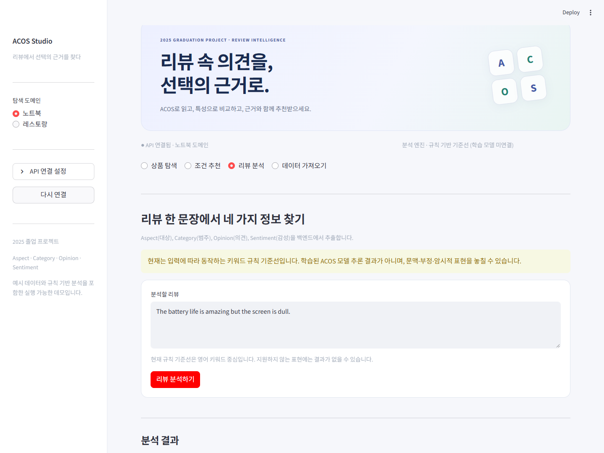

# ACOS 리뷰 기반 추천 앱

**2025년에 진행한 졸업 프로젝트입니다.** 리뷰에서 어떤 속성을 어떤 감정으로 평가했는지 정리하고, 관심 특성에 맞는 상품을 찾는 앱입니다. 기존 Flask 백엔드와 Streamlit 프론트엔드를 기반으로 상품·리뷰·분석·추천 흐름을 한 API로 연결했습니다.

## 현재 구성

- Flask REST API와 SQLite 상품·리뷰·ACOS 결과 저장
- Streamlit의 상품 탐색, 리뷰 분석, 조건 추천, 상품 상세, 데이터 가져오기
- 상품의 특성별 긍정·중립·부정 리뷰와 추천 근거 표시
- 외부 데이터 없이 시작할 수 있는 직접 작성한 합성 데모
- 입력 문장에 반응하는 규칙 기반 분석과 실제 모델을 위한 predictor 경계

학습된 ACOS 모델 가중치는 포함하지 않습니다. 기본 분석은 규칙 기반 baseline이며, 논문의 모델 성능이나 실제 사용자 만족도를 재현했다고 주장하지 않습니다.

## 실행

Python 3.11 이상을 사용합니다.

~~~powershell
python -m venv .venv
.\.venv\Scripts\python.exe -m pip install -r requirements.txt
Copy-Item .env.example .env
.\.venv\Scripts\python.exe run.py
~~~

- 프론트엔드: http://127.0.0.1:8501
- 백엔드 상태: http://127.0.0.1:5001/api/health
- 종료: 실행 터미널에서 Ctrl+C

run.py는 Waitress 백엔드를 먼저 확인한 뒤 Streamlit을 시작합니다. 이미 사용 중인 포트는 덮어쓰지 않습니다. 다른 포트가 필요하면 다음처럼 지정합니다.

~~~powershell
.\.venv\Scripts\python.exe run.py --backend-port 5011 --frontend-port 8511
~~~

macOS/Linux에서는 .venv/bin/python을 사용합니다. 개별 실행과 환경변수는 [실행 안내](docs/running.md)에 있습니다.

## 화면 흐름

1. 도메인을 선택하고 상품·리뷰의 감정 분포를 확인합니다.
2. 리뷰 문장을 입력해 속성·카테고리·의견·감정을 확인합니다.
3. 관심 카테고리와 특성을 선택하고 AND/OR 조건으로 추천받습니다.
4. 상품 상세에서 실제 저장된 리뷰와 추천 근거를 확인합니다.
5. JSON/TSV는 미리보기를 거쳐 명시적으로 가져옵니다.

화면과 백엔드가 같은 상품·리뷰 데이터를 사용합니다. 서버가 연결되지 않으면 연결 오류를 표시하며 다른 가짜 결과로 대체하지 않습니다.

## 화면

합성 데모 상품을 사용하는 실제 로컬 실행 화면입니다. 분석 화면의 결과는 학습 모델이 아닌 규칙 기반 baseline입니다.

## 구조

~~~text
Streamlit ── Requests ── Flask API ── 서비스 / 추천 규칙 ── SQLite
                            │
                     분석기 경계
                     규칙 baseline / 외부 predictor
~~~

| 경로 | 역할 |
|---|---|
| acos-backend/app.py | Flask 앱 팩토리와 호환 엔트리 |
| acos-backend/acos_app/ | 입력 검증, 분석, 상품·리뷰 저장, 추천 API |
| acos-backend/serve.py | 로컬 Waitress 서버 |
| acos-frontend/acos_reco/streamlit_app.py | 연결된 화면 |
| acos-frontend/acos_reco/src/ | API 클라이언트, 가져오기, 기존 데이터 유틸 |
| run.py | 백엔드·프론트엔드 통합 실행 |
| tests/ | API·저장·추천·파서·화면·실행 검사 |

기존 PyTorch/BERT Extract-Classify 연구 코드는 보존했지만 기본 실행 경로에서 import하거나 학습하지 않습니다. 무거운 모델 환경과 애플리케이션 환경을 분리합니다.

## 데이터와 분석 모드

첫 실행에서는 비어 있는 로컬 DB에 합성 리뷰를 넣어 탐색과 추천을 확인할 수 있습니다. 기존 데이터가 있는 DB는 초기화하거나 삭제하지 않습니다. 실제 DB와 모델, 원본 리뷰는 Git에 올리지 않습니다.

카테고리·감정·특성의 집계와 추천 점수는 설명 가능한 규칙입니다. 현재 기본 분석은 문장의 단어·표현을 이용하며, 문맥·부정·암시적 속성 처리에는 제한이 있습니다. 실제 모델이 연결되지 않은 상태를 학습 모델 추론으로 표시하지 않습니다.

## 테스트

~~~powershell
.\.venv\Scripts\python.exe -m pip install -r requirements-dev.txt
.\.venv\Scripts\python.exe -m pytest -q
~~~

[검증 범위](docs/testing.md), [API 계약](docs/api.md), [설계와 한계](docs/architecture.md)를 참고하세요. GitHub Actions는 Windows·Linux에서 애플리케이션 테스트를 실행합니다.

## 연구 출처

ACOS는 Aspect·Category·Opinion·Sentiment 네 요소를 다루는 추출 과제입니다. [Cai et al., ACL 2021](https://aclanthology.org/2021.acl-long.29/)와 [NUSTM/ACOS](https://github.com/NUSTM/ACOS)의 연구 구현은 원 저자들의 작업입니다. 이 저장소의 애플리케이션 연결·저장·추천 흐름과 구분합니다.

기존 코드의 저작권·출처는 [ATTRIBUTION.md](ATTRIBUTION.md)와 [NOTICE](NOTICE)에 보존했습니다. 논문 benchmark 점수는 이 앱의 자체 실험 결과가 아닙니다.

이 저장소는 공개 소스이며 인터넷 서비스로 배포한 것이 아닙니다. 기본 서버는 localhost 전용입니다. 외부 운영 전에는 사용자 인증, 요청 제한, HTTPS, 백업·데이터 이용 권한을 별도로 준비해야 합니다.
